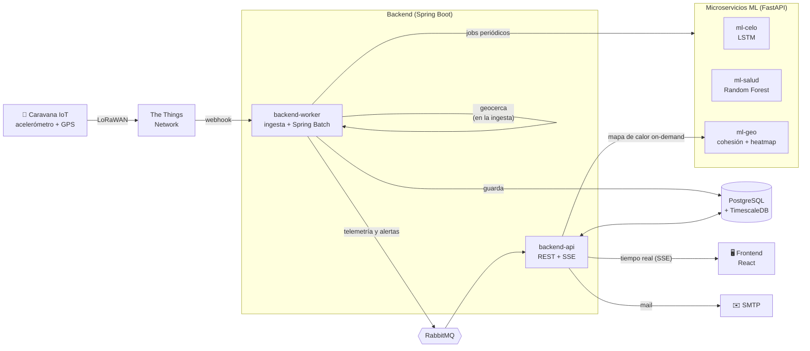

# VigIA

**Monitoreo de bovinos con caravanas IoT e inteligencia artificial.**
VigIA escucha lo que el animal ya está diciendo con su comportamiento (cuánto se mueve, dónde pasta, si se aparta del grupo) y lo convierte en alertas concretas para el productor: *esta vaca está en celo*, *esta otra está por enfermarse*, *estas dos salieron del perímetro*.

> Proyecto Final de Ingeniería en Sistemas de Información — UTN FRBA, 2026.
> *Desarrollo de un sistema de detección de celo y estado de salud en bovinos mediante sensores inerciales y de posición.*

📁 [Drive del proyecto](https://drive.google.com/drive/folders/1OaNcqx1iyuzeKOyNrNP1Tt-S7YMCXce3) · 🛠️ [Guía de desarrollo y despliegue](docs/DESARROLLO.md)

---

## El problema

En un tambo mediano, la eficiencia reproductiva y la sanidad del rodeo se gestionan de forma **reactiva y manual**. Las señales que anticipan un celo o el inicio de una enfermedad aparecen en el comportamiento del animal *antes* de ser visibles a simple vista, pero nadie las está mirando:

- **Un celo no detectado** son 21 días más de intervalo parto-concepción.
- **Una enfermedad detectada tarde** es un tratamiento más caro y más riesgo de descarte.
- **El campo extensivo queda sin control de noche**, y un robo (abigeato) se descubre al día siguiente.

Las soluciones que existen son importadas, caras y de ecosistema cerrado. VigIA apunta al segmento que quedó afuera: el **tambo mediano argentino**.

## Qué hace VigIA

Cada animal lleva una caravana con acelerómetro y GPS que transmite por LoRaWAN. Con esa telemetría, la plataforma genera:

| Alerta | Qué detecta | Cómo |
|---|---|---|
| 🐄 **Celo** | Aumento brusco y sostenido de la actividad en las últimas 24 h | Red neuronal **LSTM** sobre la serie temporal de movimiento ([`ml-celo`](ml-celo/README.md)) |
| 🩺 **Salud** | Desvíos de comportamiento que anticipan síntomas visibles (objetivo: hasta **48 h antes**) | **Perfil individual** por animal (7 días de calibración) + **Random Forest** sobre z-scores de desvío ([`ml-salud`](ml-salud/README.md)) |
| 🧭 **Aislamiento social** | Un animal (o un subgrupo) que se aparta del rodeo y no vuelve | Grafo de proximidad entre animales con Haversine; el grupo principal es la componente conexa más grande ([`ml-geo`](ml-geo/README.md)) |
| 🚧 **Fuera de perímetro** | Salida de un perímetro virtual del establecimiento o lote (riesgo de abigeato) | Verificación de geocerca **en el momento de la ingesta**, sin esperar al batch |
| 📅 **Anestro** | Vacas que llevan demasiado tiempo sin señales de ciclo (celo, inseminación, parto) | Job diario con umbral de días configurable por establecimiento |

Además: **mapa del rodeo en tiempo real**, **mapas de calor de pastoreo** por rodeo, lote o animal, **historial clínico y reproductivo** por animal, registro de intervenciones y diagnósticos, y notificaciones por mail.

### Para quién

| Rol | Qué hace en la plataforma |
|---|---|
| **Productor** | Toma las decisiones operativas: ve el dashboard, el mapa, las alertas y gestiona su rodeo y su equipo. |
| **Veterinario** | Hace el seguimiento sanitario y reproductivo: diagnósticos, intervenciones, historial clínico. |
| **Campero** | Atiende las alertas en el campo. |
| **Administrador** | Da de alta establecimientos, caravanas y productores (rol global de la plataforma). |

---

## Cómo funciona



**El recorrido de un dato:**

1. La caravana transmite un paquete con posición, estado de movimiento y batería. **The Things Network** lo reenvía por webhook al `backend-worker`.
2. El worker lo guarda en una hypertable de **TimescaleDB**, chequea en el momento si el animal salió de su perímetro y publica el evento en **RabbitMQ**.
3. El `backend-api` consume ese evento y lo empuja por **Server-Sent Events** al mapa en vivo del frontend.
4. En paralelo, **Spring Batch** junta periódicamente la telemetría pendiente y se la manda a los microservicios de ML. Si alguno detecta algo, se crea la alerta, se publica en la cola y le llega al usuario en la web y por mail.

---

## Decisiones de diseño que vale la pena mirar

**Cada vaca se compara contra sí misma.** Una vaca naturalmente tranquila y una inquieta no pueden medirse con la misma vara. `ml-salud` construye un perfil de referencia por animal durante 7 días de calibración y evalúa cada día contra *ese* perfil, no contra el promedio del rodeo. El celo, en cambio, sí es un patrón poblacional, por eso usa otro modelo.

**El sistema no se cae si el ML se cae.** Cada llamada a un microservicio pasa por **Resilience4j** (timeouts, reintentos, circuit breaker). Si `ml-celo` no responde, la telemetría queda marcada como `INFERENCIA_PENDIENTE` y se procesa en el próximo ciclo: no se pierde ningún dato.

**Ingesta y consulta separadas.** El `backend-worker` recibe la telemetría y corre los jobs pesados; el `backend-api` atiende al usuario. Comparten entidades y lógica en `backend-core-lib`, pero escalan y se despliegan por separado.

**"Aislado" tiene una definición precisa.** Dos animales están juntos si están a menos del umbral configurado por establecimiento. Los que están juntos, directa o encadenadamente, forman un grupo, y el más grande es el rodeo. Así, un subgrupo que se aleja *junto* también se detecta, y la alerta solo se dispara si el animal lleva un tiempo mínimo afuera sin volver. Ver [`ml-geo`](ml-geo/README.md).

**Datos sintéticos que se parecen a los reales.** Mientras no hay dataset de campo etiquetado, los modelos se entrenan con datos sintéticos a los que se les agrega el ruido de medición de un GPS real y la cadencia real de *heartbeat* de las caravanas. Ver [`ml-training`](ml-training/README.md).

**Probado con 25.000 sensores.** El stack se sometió a una prueba de carga con k6 que simula 500 clientes × 50 caravanas (más de 7 millones de puntos de telemetría), verificando además que el movimiento normal no genere alertas falsas. Ver [`loadtest`](loadtest/README.md).

**Una demo que no depende del azar.** El [`simulador`](simulador/README.md) emula un rodeo completo transmitiendo por el mismo webhook que usa TTN, con escenarios guionados para mostrar de punta a punta cada tipo de alerta: celo, fuga del perímetro, desvío sanitario y aislamiento.

---

## Stack

| Capa | Tecnologías |
|---|---|
| **Frontend** | React 18, TypeScript, Vite, React Query, Zustand, Leaflet, Recharts, Zod |
| **Backend** | Java 17, Spring Boot 3 (Web, Data JPA, Batch, Security + OAuth2), Resilience4j |
| **Machine Learning** | Python, FastAPI, TensorFlow/Keras (LSTM), scikit-learn (Random Forest) |
| **Datos y mensajería** | PostgreSQL + TimescaleDB, RabbitMQ |
| **IoT** | Caravanas LoRaWAN, The Things Network |
| **Infra** | Docker Compose, GitHub Actions, Railway, k6 |

## Estructura del repositorio

| Carpeta | Qué hay |
|---|---|
| [`frontend/`](frontend/README.md) | Aplicación web: landing, dashboard, mapa en vivo, alertas, gestión del rodeo. |
| [`backend/`](backend/README.md) | Spring Boot multi-módulo: `backend-api`, `backend-worker`, `backend-core-lib`. |
| [`ml-celo/`](ml-celo/README.md) | Microservicio de detección de celo. |
| [`ml-salud/`](ml-salud/README.md) | Microservicio de detección de desvíos sanitarios. |
| [`ml-geo/`](ml-geo/README.md) | Microservicio de cohesión del rodeo y mapas de calor. |
| [`ml-training/`](ml-training/README.md) | Generación de datasets sintéticos y entrenamiento offline de los modelos. |
| [`simulador/`](simulador/README.md) | Simulador de caravanas y escenarios de demo. |
| [`loadtest/`](loadtest/README.md) | Prueba de carga con k6. |
| `infra/` | Docker Compose y configuración del entorno. |

## Levantarlo en 2 minutos

Con Docker instalado:

```bash
cd infra
docker-compose up -d --build
```

```bash
cd frontend
npm install && npm run dev
```

El frontend queda en `http://localhost:5173`, la API en `http://localhost:8080` y los mails simulados en `http://localhost:8025`. Para desarrollo local por módulo, el simulador, el CI y el despliegue en Railway, ver la **[guía de desarrollo](docs/DESARROLLO.md)**.

---

## Equipo

| Integrante | Rol |
|---|---|
| Santiago Mendez | Project Manager |
| Julián Cardoso Landin | Product Owner |
| Tomás Agustín Fabrizio | Arquitecto de Software |
| Matías Gabriel Jastrebow | Líder Técnico |
| Iñaki Joaquín Lorences | Scrum Master |

**Cátedra de Proyecto Final — UTN FRBA.** Directora de cátedra y profesora a cargo del curso: Mag. Ing. Gabriela Salem. Profesores a cargo del proyecto: Ing. Andrea Alegretti e Ing. Pablo Abramowicz.
